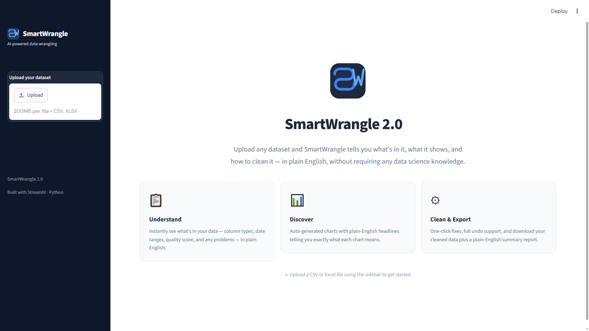
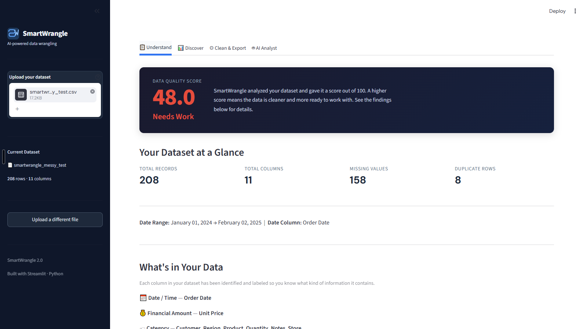
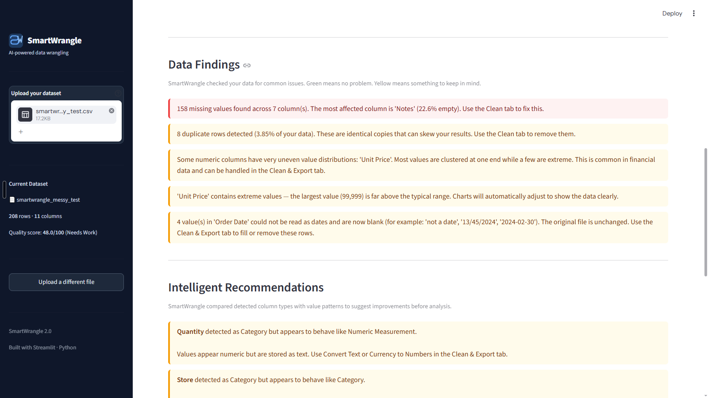
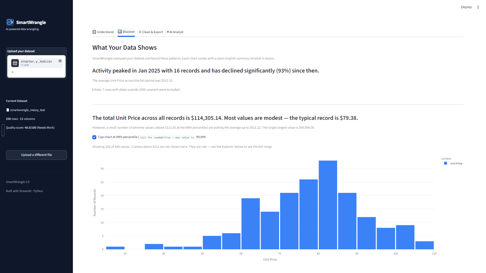
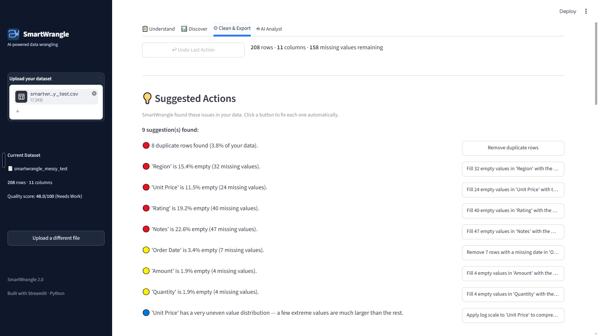
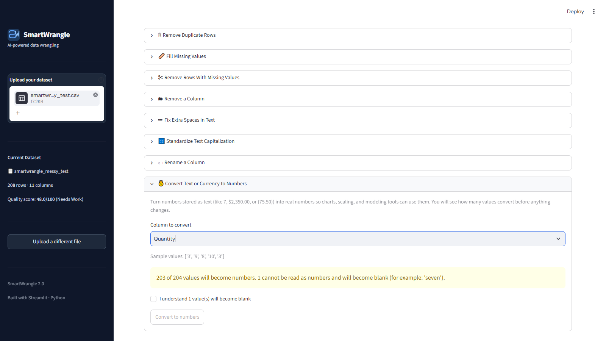

# SmartWrangle

**Upload a messy spreadsheet. SmartWrangle tells you what is in it, what it shows, and how to clean it, in plain English.**

[](https://smartwrangle.streamlit.app)
[](https://python.org)
[](https://streamlit.io)



---

## What It Does

SmartWrangle is a guided data cleaning and exploration app. You upload a CSV or Excel file and work through four tabs:

| Tab | The question it answers | What you get |
|---|---|---|
| **Understand** | What is in my data? | A quality score out of 100, row and column counts, missing values, duplicates, column types, and plain-English findings |
| **Discover** | What does my data show? | Charts picked automatically for your data, each with a one-sentence headline, plus a chart builder |
| **Clean & Export** | How do I fix it? | Suggested fixes with one-click buttons, cleaning and preparation tools, full undo, and downloads |
| **AI Analyst** | What should I do next? | Ask questions in plain English. Claude answers using a summary of your data (never the raw rows) |

No data science background is needed. Every finding and every tool is explained in plain language.

---

## Screenshots

**Quality score and summary.** Every upload gets a score and a quick overview.



**Plain-English findings.** Problems are listed in words, including values that could not be read as dates.



**Automatic charts with headlines.** Each chart comes with a sentence explaining what it shows.



**Suggested fixes.** SmartWrangle finds the problems and offers a button for each fix.



**Safe conversions.** Before turning text into numbers, the app shows how many values cannot be converted and asks you to confirm.



---

## Features

### Understand
- Quality score from 0 to 100 with a grade (Excellent, Good, Fair, Needs Work)
- Counts of rows, columns, missing values, and duplicate rows
- Each column labeled as a date, money amount, number, category, free text, or identifier
- Plain-English findings about missing values, duplicates, uneven number spreads, and extreme values
- A warning when values in a date column could not be read as dates (for example "2024-02-30")
- Recommendations when a column's values do not match its type (for example numbers stored as text)
- Data preview and an advanced section with per-column statistics

### Discover
- Charts chosen automatically: trends over time, category breakdowns, and number spreads
- A headline above every chart that states the main finding
- Long-tail values handled for readability (top 10 categories, optional 99th percentile cap)
- Chart builder: bar, scatter, histogram (with optional log scale), and line over time

### Clean & Export
- Suggested actions ranked by priority, each with a one-click fix
- Remove duplicate rows, with a side-by-side preview first
- Fill missing values with the median, mean, most common value, or a value you choose (median and mean are offered only for number columns)
- Remove rows with missing values, in any column or in one column
- Remove or rename a column
- Trim extra spaces and standardize capitalization (blank cells stay blank)
- Convert text or currency to numbers, with a preview and a confirmation step whenever values would be lost
- Preparation for modeling: log scale, standard scale, 0 to 1 scale, one-hot encoding, and extracting year, month, or day from a date
- Undo for every action, plus a running action history
- Download the cleaned data as CSV and a plain-English summary report as a text file

### AI Analyst
- Ask questions about your dataset and get answers that reference your actual columns and findings
- Only a summary is sent to the AI: column types, statistics, and quality findings. Raw rows never leave the app.
- Suggested starter questions, follow-up questions, and a clear-conversation button
- Uses Claude Haiku 5.5 through the Anthropic API

---

## Run It on Your Computer

### Windows (one command)

1. Install [Python 3.12](https://www.python.org/downloads/) if you do not have it.
2. Download or clone this repository:
   ```
   git clone https://github.com/kalopez0621/smartwrangle.git
   ```
3. Open the `smartwrangle` folder and double-click **`run.bat`**.

The first run creates a virtual environment and installs the packages, which takes a few minutes. After that it starts in seconds. The app opens at `http://localhost:8501`. To stop it, click the black window and press **Ctrl+C**.

### macOS or Linux

```bash
git clone https://github.com/kalopez0621/smartwrangle.git
cd smartwrangle
python3.12 -m venv venv
source venv/bin/activate
pip install -r requirements.txt
streamlit run app.py
```

### Turn on the AI Analyst (optional)

The other three tabs work without this.

1. Get an API key from the [Claude Console](https://platform.claude.com).
2. In the project folder, make a copy of `.env.example` and name it `.env`.
3. Open `.env` and replace the placeholder with your key:
   ```
   ANTHROPIC_API_KEY=your-key-here
   ```
4. Refresh the app page.

`.env` is listed in `.gitignore`, so your key is never uploaded to GitHub.

---

## Deploy on Streamlit Community Cloud

1. Push this repository to your GitHub account.
2. At [share.streamlit.io](https://share.streamlit.io), create an app from the repository, with `app.py` as the main file. Under **Advanced settings**, choose Python 3.12 or newer.
3. In the app's **Settings > Secrets**, add:
   ```
   ANTHROPIC_API_KEY = "your-key-here"
   ```
4. Every push to the `main` branch redeploys the app automatically.

**About API cost:** visitors who use the AI Analyst spend your API credits. Each question costs a fraction of a cent with Claude Haiku 5.5, but a public link can be shared. Use a separate key for this app and set a monthly spend limit in the Claude Console.

---

## Test Data

`test_data/smartwrangle_messy_test.csv` (and the matching `.xlsx`) is a 208-row file with problems planted on purpose:

- Blank cells and 8 exact duplicate rows
- Dollar amounts and quantities stored as text, including accounting negatives like `($1,250.00)` and the word "seven"
- Dates in two formats plus bad values like "not a date" and "2024-02-30"
- Extra spaces, inconsistent capitalization (including in a column header), and one extreme price outlier
- A column with only one value

`test_data/make_test.py` rebuilds the file. Every feature was also tested against three public messy datasets from Kaggle (cafe sales, Netflix titles, and Glassdoor job postings).

---

## Project Structure

```
smartwrangle/
├── app.py                  # Entry point: page setup, sidebar, file upload, tab routing
├── run.bat                 # Windows one-command launcher
├── requirements.txt        # Pinned package versions
├── .env.example            # Template for the local API key file
├── .streamlit/
│   └── config.toml         # Theme, upload size, and security settings
├── engine/                 # Analysis and cleaning logic (no Streamlit code)
│   ├── detector.py         # Labels each column's type; converts date text to dates
│   ├── quality.py          # Quality score and plain-English findings
│   ├── insights.py         # Automatic charts and their headlines
│   └── cleaner.py          # Every cleaning and preparation operation
├── tabs/                   # One file per tab
│   ├── understand.py
│   ├── discover.py
│   ├── clean_export.py
│   └── analyst.py
├── utils/
│   ├── sanitizer.py        # Makes tables safe to display; tidies column names
│   └── exporter.py         # CSV download and summary report
├── test_data/              # Messy test file and the script that builds it
└── docs/screenshots/       # Images used in this README
```

**How the pieces fit:** the `engine/` functions take a table and return a new table plus a plain-English message describing what changed. The uploaded file is never modified. The app keeps a working copy, and every change saves a snapshot first, which is what makes Undo possible.

---

## Tech Stack

| Layer | Technology |
|---|---|
| App framework | Streamlit 1.65 |
| Data | pandas 3, NumPy |
| Charts | Plotly |
| Scaling | scikit-learn |
| Excel files | openpyxl |
| AI Analyst | Anthropic API (Claude Haiku 5.5), python-dotenv |
| Language | Python 3.12 (also runs on 3.13) |

---

## Roadmap (Version 2)

These are planned, not built:

- Logins, usage limits, and payments, so the app can run as a hosted service
- Treat placeholder words like "ERROR", "UNKNOWN", "N/A", or -1 as missing values
- Pull numbers out of text, for example "93 min" or "$137K-$171K"
- Reset to the original upload in one click
- A general column type converter (text to number or date)
- Box plots in the chart builder
- PDF report
- Support for older `.xls` Excel files

---

## About

Built as a portfolio project for a dual bachelor's program in Data Analytics and Applied AI. The goal was a tool that walks anyone, technical or not, through the full path from a messy file to clean, analysis-ready data.
